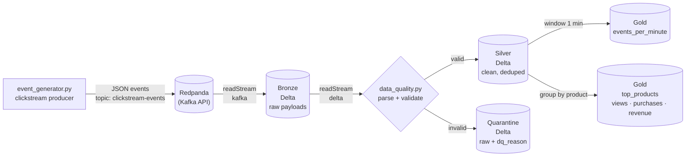

# Realtime Streaming Lakehouse

A production-style streaming data pipeline: synthetic e-commerce clickstream events flow through **Redpanda (Kafka-compatible)** into **PySpark Structured Streaming**, landing in a **Delta Lake medallion architecture** (bronze → silver → gold) with **data-quality checks and a quarantine table** baked into the stream. Built to show how I design event-driven lakehouses — exactly-once semantics, late-data handling, and bad-record isolation included.

Everything runs locally with Docker. No cloud accounts, no credentials.



## Tech stack

| Layer | Technology |
|---|---|
| Event broker | Redpanda (Kafka-compatible, single container) + Redpanda Console UI |
| Stream processing | Apache Spark 3.5 Structured Streaming (PySpark) |
| Storage | Delta Lake 3.2 on local filesystem (bronze / silver / quarantine / gold) |
| Producer client | confluent-kafka (Python) |
| Orchestration | n/a — five streaming queries with independent checkpoints |

## Prerequisites

- Docker + Docker Compose
- Python 3.10 or 3.11
- Java 11 or 17 (required by Spark)

## Quickstart

**1. Start Redpanda + Console**

```bash
docker compose up -d
# Console UI: http://localhost:8080
```

**2. Install Python dependencies**

```bash
python -m venv .venv && source .venv/bin/activate
pip install -r requirements.txt
```

**3. Generate clickstream events** (topic is auto-created on first produce)

```bash
python src/event_generator.py --rate 100 --duration 180
```

Options: `--rate` events/sec, `--duration` seconds (`0` = run until Ctrl+C),
`--bad-record-rate` fraction of intentionally malformed events (default `0.03`).

**4. Run the streaming pipeline**

```bash
python src/streaming_app.py
```

By default this runs in one-shot mode (`availableNow`): it drains everything in
the topic, writes all five Delta tables, and exits. For a long-running stream:

```bash
python src/streaming_app.py --continuous
```

Environment overrides: `KAFKA_BOOTSTRAP_SERVERS`, `KAFKA_TOPIC`.

**5. Query the gold tables**

```bash
spark-sql \
  --packages io.delta:delta-spark_2.12:3.2.1,org.apache.spark:spark-sql-kafka-0-10_2.12:3.5.3 \
  --conf spark.sql.extensions=io.delta.sql.DeltaSparkSessionExtension \
  --conf spark.sql.catalog.spark_catalog=org.apache.spark.sql.delta.catalog.DeltaCatalog
```

```sql
-- events per minute by type
SELECT minute, event_type, event_count, unique_users
FROM delta.`data/delta/gold/events_per_minute`
ORDER BY minute DESC, event_count DESC
LIMIT 20;

-- top products by revenue
SELECT product_id, category, views, purchases, revenue
FROM delta.`data/delta/gold/top_products`
ORDER BY revenue DESC
LIMIT 10;

-- what got quarantined, and why
SELECT dq_reason, COUNT(*) AS bad_records
FROM delta.`data/delta/quarantine`
GROUP BY dq_reason
ORDER BY bad_records DESC;
```

## Project structure

```
realtime-streaming-lakehouse/
├── docker-compose.yml      # Redpanda + Console (single-node dev)
├── requirements.txt        # pinned: pyspark 3.5.3, delta-spark 3.2.1, confluent-kafka 2.8.0
├── src/
│   ├── event_generator.py  # synthetic clickstream producer (shopping-funnel behavior model)
│   ├── streaming_app.py    # 5 Structured Streaming queries: bronze/silver/quarantine/2x gold
│   └── data_quality.py     # shared schema + reusable DQ checks (parse, validate, split)
├── data/                   # created at runtime: delta/ + checkpoints/ (gitignored)
├── LICENSE                 # MIT
└── README.md
```

## Data quality rules

Checks live in `src/data_quality.py` and run inside the stream on every micro-batch.
Failed records are **never dropped silently** — they land in the `quarantine` Delta
table with their raw payload and a `dq_reason` so they can be inspected and reprocessed.

| Rule | `dq_reason` value |
|---|---|
| Payload is not valid JSON / doesn't match schema | `malformed_json` |
| `event_id` is null | `null_event_id` |
| `user_id` is null | `null_user_id` |
| `event_type` missing or not in the allowed set | `invalid_event_type` |
| `event_time` not a parseable ISO-8601 timestamp | `unparseable_event_time` |
| `price` present but negative | `negative_price` |
| Product event (`product_view`, `add_to_cart`, `purchase`) without `product_id` | `missing_product_id` |

Exactly-once hygiene beyond validation:

- **Deduplication**: `dropDuplicates(["event_id"])` with a 10-minute watermark on
  `event_time` in the silver query (idempotent producer on the generator side).
- **Late data**: 10-minute watermarks on all stateful aggregations; late events
  past the watermark are dropped by the engine rather than corrupting windows.
- **Fault isolation**: each of the five queries has its own checkpoint directory,
  so a failure in a gold aggregate never blocks bronze ingestion.

## Sample output

Example rows from `gold_events_per_minute` after a 3-minute generator run
(~18k events, 3% bad-record rate):

| minute | event_type | event_count | unique_users |
|---|---|---|---|
| 2026-10-08 21:10:00 | page_view | 2124 | 486 |
| 2026-10-08 21:10:00 | product_view | 1487 | 402 |
| 2026-10-08 21:10:00 | search | 731 | 311 |
| 2026-10-08 21:10:00 | add_to_cart | 268 | 190 |
| 2026-10-08 21:10:00 | purchase | 94 | 88 |

Example quarantine breakdown from the same run:

| dq_reason | bad_records |
|---|---|
| invalid_event_type | 148 |
| unparseable_event_time | 141 |
| negative_price | 129 |
| malformed_json | 122 |

(The generator injects ~3% bad records on purpose — quarantine the evidence, don't delete it.)

## Design notes

- **Why Redpanda instead of Kafka?** One container, no ZooKeeper/KRaft setup, and a
  wire-compatible Kafka API — so the Spark Kafka connector works unchanged. The
  pipeline would run against MSK / Confluent Cloud with only a connection-string change.
- **Why `availableNow` by default?** Demos and CI should terminate. The trigger is
  one flag away from a 24/7 stream.
- **Why separate streaming queries instead of `foreachBatch` fan-out?** Independent
  checkpoints per table: bronze ingestion keeps flowing even if a gold aggregate is
  stopped, redeployed, or backfilled.

## Cleanup

```bash
docker compose down -v   # stops Redpanda and removes its data volume
rm -rf data/             # removes local Delta tables and checkpoints
```
